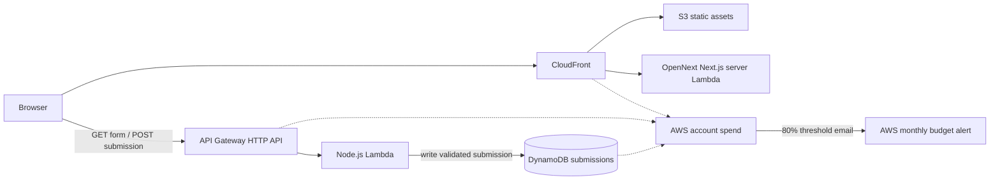

# Metadata-Driven Form Builder

A Next.js application for designing and rendering forms from metadata instead of
hard-coding each field and validation rule.

## Overview

The form builder uses a JSON-compatible schema to define fields, labels, requirements, and numeric or length constraints. The UI renders fields from the schema so forms can be changed without rewriting the component structure.

## Features

- JSON-compatible form definitions validated with Zod
- Dynamic form rendering with React Hook Form
- Visual designer with live preview and reorderable fields
- Static landing page, ISR form pages, and streamed dynamic submissions page
- AWS API Gateway, Lambda, and DynamoDB backend
- OpenNext deployment to AWS with CloudFront and S3 assets

## Project Structure

```text
src/
  app/
    designer/
    forms/[id]/
    submissions/
  components/
    dynamic-form.tsx
    designer-workspace.tsx
  lib/
    schemas.ts
    utils.ts
aws/lambda/src/handler.ts
template.yaml
sst.config.ts
```

## Form Schema

Form definitions live in `src/lib/schemas.ts`. Each field may include:

| Property | Description |
| --- | --- |
| `name` | Unique field key used in submitted form data |
| `type` | Field type, such as `text`, `email`, `number`, or `textarea` |
| `label` | Text displayed to the user |
| `required` | Whether the field must have a value |
| `min` | Minimum number or text length |
| `max` | Maximum number or text length |

Example:

```ts
import type { FormDefinition } from "@/lib/schemas"

export const formSchema = {
  title: "User Profile",
  fields: [
    {
      name: "fullName",
      type: "text",
      label: "Full Name",
      required: true,
      min: 2,
      max: 80,
    },
  ],
} satisfies FormDefinition
```

## Getting Started

Install dependencies:

```bash
npm install
```

Start the development server:

```bash
npm run dev
```

Open [http://localhost:3000](http://localhost:3000).

## Available Scripts

```bash
npm run dev       # Start the development server
npm run build     # Create a production build
npm run start     # Start the production server
npm run lint      # Run ESLint
npm test          # Run unit and component tests
npm run test:e2e  # Run Playwright end-to-end tests
```

## Tech Stack

- Next.js 16
- React 19
- TypeScript
- Tailwind CSS
- React Hook Form
- Zod

## Architecture



The frontend is deployed by SST's OpenNext adapter. It provisions the CloudFront
distribution, S3 asset bucket, and server-side Lambda required to preserve Next.js
SSG, ISR, and SSR behavior. The API and data layer are a separate SAM stack; deploy
that stack first and pass its API URL to SST as `NEXT_PUBLIC_API_URL`.

## AWS deployment

### 1. Deploy the API and data stack with SAM

The `template.yaml` stack provisions API Gateway, Node.js Lambdas, a DynamoDB
table, and a monthly budget email alert. It does not host the frontend.

Install the AWS SAM CLI and deploy (you will be prompted for the budget alert
email). Configure your AWS credentials using your normal AWS authentication
method before deploying.

```bash
sam build
sam deploy --guided
```

Copy the `ApiUrl` output. For local development, put it in `.env.local`:

```bash
NEXT_PUBLIC_API_URL=https://your-api-id.execute-api.region.amazonaws.com
```

### 2. Deploy the frontend with SST/OpenNext

SST uses OpenNext to deploy the Next.js app to CloudFront, S3, and Lambda. This
preserves server rendering and ISR; a plain static export would not support the
dynamic `/submissions` page or ISR `/forms/[id]` route.

```bash
NEXT_PUBLIC_API_URL=https://your-api-id.execute-api.region.amazonaws.com \
  npm run deploy:aws -- --stage production
```

The command prints the CloudFront site URL. SST retains production resources if
the production stage is removed. Review AWS pricing and keep the configured
budget alert; actual charges depend on usage and AWS account eligibility.

For local development, `npm run dev` runs the Next.js app directly. The AWS
backend must be deployed separately if you want to test API-backed submissions.

## Architecture decision records

### ADR 1: Zod is the validation source of truth

**Decision:** Form metadata is converted to Zod with `buildZodSchema`; the same
builder is used by the browser form and the submission Lambda.

**Rationale:** Sharing the schema construction avoids duplicating validation
rules between client and server. The browser can provide immediate feedback,
while the API independently validates untrusted submission data.

### ADR 2: Use serverless AWS infrastructure

**Decision:** Use API Gateway, Lambda, DynamoDB on-demand capacity, and SST's
OpenNext deployment for the frontend.

**Rationale:** Managed, independently scaling services avoid maintaining
long-running servers and keep idle infrastructure small. OpenNext provides the
server runtime and CDN asset hosting needed by this app's SSG, ISR, and SSR
routes. The trade-off is provider-specific infrastructure and potential
function cold starts.

## Tests

```bash
npm test
npm run test:e2e
npx playwright install chromium
```

## Performance

The designer workspace is split behind `next/dynamic` and loads on the `/designer`
route. The bundle analyzer can be run with:

```bash
npm run analyze
```

Reports are generated in `.next/analyze/`. The report showed the form route's
React Hook Form/Zod validation bundle as the largest application-specific client
dependency; `DynamicForm` now memoizes its Zod schema instead of rebuilding it
on each input-driven render.

Lighthouse CLI measurements against the production landing page (`/`, local
desktop run):

| Metric | Before | After |
| --- | ---: | ---: |
| LCP | 0.8 s | 2.3 s |
| INP | Not reported | Not reported |
| CLS | 0 | 0 |
| Total Blocking Time (lab proxy for responsiveness) | 10 ms | 0 ms |
| JavaScript transfer | 252 KB | 149 KB |
| Total transfer | 332 KB | 229 KB |

The lab run does not provide INP; collect field data to measure it. Although
JavaScript and total transfer dropped substantially, the recorded LCP increased
in this run, so verify LCP with repeated Lighthouse runs on the target deployment
before drawing conclusions.
